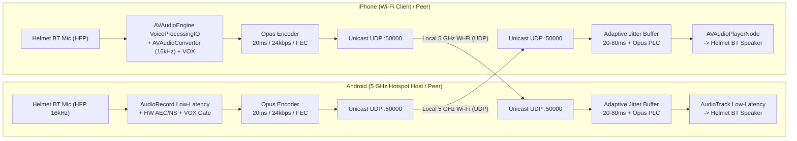
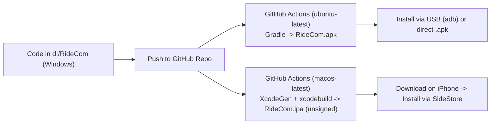

# RideCom — System Architecture & Technical Design

> **Project Goal:** Offline, ultra-low-latency, full-duplex motorcycle helmet intercom between **Android** and **iPhone** over local Wi-Fi Hotspot, supporting true background / lock-screen operation with Bluetooth HFP helmet headsets — at **zero recurring cost** (no Apple Developer account required).
>
> **Target Test Hardware:**
> - **iPhone 11** (iOS 27.0.1, Wi-Fi 6 / 2.4 & 5 GHz, Bluetooth 5.0)
> - **Samsung Galaxy A12 (`SM-A127F`)** (Android 13 / API 33, Exynos 850, Wi-Fi 4 **2.4 GHz only**, Bluetooth 5.0)
> - *Hardware Note:* Because Galaxy A12 is 2.4 GHz Wi-Fi only, Opus In-band FEC (15% expected loss) + Adaptive Jitter Buffer (default Balanced 40 ms) are enabled by default to absorb 2.4 GHz Wi-Fi/Bluetooth coexistence interference cleanly.

---

## 1. Design Principles & Core Constraints

| Requirement | Target / Strategy |
|---|---|
| **Offline-First** | 100% local Wi-Fi / Hotspot LAN. Zero internet, zero cloud signaling, zero STUN/TURN. |
| **Low Latency** | Target ~40–70 ms transport+codec overhead (total ~200–320 ms including BT HFP hardware delay). |
| **No Stutter / Instant Auto-Heal** | Stateless Unicast UDP + Opus (FEC/PLC) + tunable Jitter Buffer. If riders separate and return into Wi-Fi range, voice resumes immediately without reconnecting. |
| **True Lock-Screen Operation** | Android `ForegroundService` (`microphone`) + `PARTIAL_WAKE_LOCK` + `WIFI_MODE_FULL_LOW_LATENCY`. iOS `UIBackgroundModes: audio` + persistent `AVAudioSession`. |
| **Free Apple ID / SideStore Safe** | Uses **zero** paid-only entitlements (no PushKit, no Multicast entitlement). Discovery uses Bonjour/mDNS (`NSBonjourServices`) + Unicast UDP + Gateway/QR fallback. |
| **Windows-Only Dev Workflow** | Android `.apk` and unsigned iOS `.ipa` (for SideStore/AltStore) built automatically via **GitHub Actions** (`ubuntu-latest` + `macos-latest` + `XcodeGen`). |

---

## 2. Recommended Tech Stack

### Pure Native Monorepo: **Kotlin (Android)** + **Swift (iOS)**

Why Pure Native instead of Flutter / React Native?
1. **Audio & Bluetooth Reliability:** Bluetooth HFP SCO routing, low-latency audio buffers, and lock-screen background audio are deeply OS-specific. Pure native eliminates cross-platform plugin bugs and GC/bridge latency.
2. **Smaller & Faster:** ~5–15 MB binaries, native UI (Jetpack Compose & SwiftUI) for only 3 glove-friendly screens.
3. **Clean CI on Windows:** Gradle for Android + `XcodeGen` (`project.yml`) + `xcodebuild` on GitHub Actions `macos-latest` for unsigned `.ipa` — no CocoaPods/Flutter version conflicts.

### Repository Layout (Planned)

```text
d:\RideCom\
├── AGENTS.md
├── docs/
│   └── ARCHITECTURE.md          # This design document & protocol spec
├── android/                     # Kotlin + Jetpack Compose + Gradle + libopus
│   ├── app/src/main/java/com/ridecom/
│   │   ├── audio/               # Low-latency AudioRecord/AudioTrack, BT SCO, VOX
│   │   ├── codec/               # Opus JNI wrapper (or native CMake libopus)
│   │   ├── network/             # NsdManager discovery + UDP engine + JitterBuffer
│   │   ├── service/             # ForegroundService + WakeLock + WifiLock
│   │   └── ui/                  # Compose screens (Home, Active Call, Settings)
│   └── ...
├── ios/                         # Swift + SwiftUI + XcodeGen + SPM Opus
│   ├── project.yml              # XcodeGen spec (generates .xcodeproj on CI)
│   ├── RideCom/
│   │   ├── Audio/               # AVAudioEngine + VoiceProcessingIO + AVAudioConverter + VOX
│   │   ├── Codec/               # Opus Swift wrapper
│   │   ├── Network/             # NWBrowser/NWListener (Bonjour) + NWConnection UDP + JitterBuffer
│   │   └── UI/                  # SwiftUI views (Home, Active Call, Settings)
│   └── ...
└── .github/
    └── workflows/
        └── build.yml            # Builds RideCom.apk & unsigned RideCom.ipa
```

---

## 3. High-Level System Architecture



---

## 4. RideCom Wire Protocol v1 (Shared by Android & iOS)

### 4.1 Audio Parameters
- **Sample Rate:** `16,000 Hz` (Wideband speech — matches Bluetooth HFP mSBC natively, minimizes resampling)
- **Channels:** `1` (Mono)
- **PCM Format:** `Int16` (`320` samples per frame = `20 ms`)
- **Codec:** `Opus` (`OPUS_APPLICATION_VOIP`)
  - Default Bitrate: `24 kbps` (~60 bytes per 20ms packet, configurable 16 / 24 / 32 kbps)
  - `OPUS_SET_INBAND_FEC(1)` + `OPUS_SET_PACKET_LOSS_PERC(10)` for resilient Wi-Fi audio
  - Packet Loss Concealment (PLC) invoked on missing frames

### 4.2 Binary UDP Packet Format (Port `50000`)

All multi-byte integers are **Big-Endian (Network Byte Order)**.

```text
 0                   1                   2                   3
 0 1 2 3 4 5 6 7 8 9 0 1 2 3 4 5 6 7 8 9 0 1 2 3 4 5 6 7 8 9 0 1
+-+-+-+-+-+-+-+-+-+-+-+-+-+-+-+-+-+-+-+-+-+-+-+-+-+-+-+-+-+-+-+-+
|     Magic ('R','C')           |  Ver  |  Type |     Flags     |
+-+-+-+-+-+-+-+-+-+-+-+-+-+-+-+-+-+-+-+-+-+-+-+-+-+-+-+-+-+-+-+-+
|        Sequence (uint16)      |        SenderID (uint16)      |
+-+-+-+-+-+-+-+-+-+-+-+-+-+-+-+-+-+-+-+-+-+-+-+-+-+-+-+-+-+-+-+-+
|                       Timestamp (uint32)                      |
+-+-+-+-+-+-+-+-+-+-+-+-+-+-+-+-+-+-+-+-+-+-+-+-+-+-+-+-+-+-+-+-+
|                     Opus / Control Payload ...                |
+-+-+-+-+-+-+-+-+-+-+-+-+-+-+-+-+-+-+-+-+-+-+-+-+-+-+-+-+-+-+-+-+
```

- **Header Size:** `12 bytes`
- **Magic:** `0x52 0x43` (`"RC"`)
- **Version (4 bits):** `1`
- **Type (4 bits):**
  - `0x1` = `AUDIO` (Opus frame payload)
  - `0x2` = `HELLO` (Peer handshake / keepalive; payload = UTF-8 device name)
  - `0x3` = `HELLO_ACK` (Handshake reply; payload = UTF-8 device name)
  - `0x4` = `PING` (RTT measurement; payload = 8-byte client monotonic ms)
  - `0x5` = `PONG` (Echoes PING payload for RTT calculation)
  - `0x6` = `BYE` (Graceful disconnect)
- **Flags (8 bits):**
  - Bit 0: `VOICE_ACTIVE` (1 = speech, 0 = silence/VOX closed)
  - Bit 1: `PTT_ACTIVE` (1 = push-to-talk held)
  - Bit 2: `FEC_PRESENT` (hint)

### 4.3 Adaptive Jitter Buffer
- Ring buffer indexed by `Sequence (uint16)` (wrap-around safe).
- User-selectable modes:
  - **Ultra-Low (20 ms / 1 frame)** — best for very close bikes on clean 5 GHz Wi-Fi
  - **Balanced (40 ms / 2 frames — Default)** — smooth with minimal lag
  - **Stable (80 ms / 4 frames)** — for noisy RF or slightly longer distance
  - **Auto (20–100 ms)** — dynamically expands on jitter spikes, slowly shrinks when stable
- On missing sequence:
  - If next packet arrived with In-band FEC → decode FEC recovery frame.
  - Otherwise → decode `null` payload with Opus PLC (max 3 consecutive PLC frames, then fade smoothly to silence).

### 4.4 Peer Discovery (Zero-Config + Reliable Fallback)
1. **Primary — Bonjour / mDNS:**
   - Service type: `_ridecom._udp.` on port `50000`
   - Android: `NsdManager`
   - iOS: `NWListener` + `NWBrowser` (`Info.plist`: `NSBonjourServices` = `["_ridecom._udp"]`, `NSLocalNetworkUsageDescription`)
   - Works on Free Apple ID without multicast entitlement.
2. **Fallback — Direct Hotspot IP / QR Code:**
   - Android Hotspot host displays its local IP + scannable QR code (`ridecom://192.168.x.x:50000`).
   - iOS auto-suggests the local Wi-Fi subnet gateway (`x.x.x.1`) as a 1-tap "Connect to Hotspot Host" button (works even if OEM Hotspot blocks mDNS).
   - Remembers last peer IP for instant 1-tap reconnect.

---

## 5. Platform-Specific Audio & Background Architecture

### 5.1 Android (Min SDK 26 / Android 8.0+, Target SDK 35)
- **Bluetooth HFP Routing:**
  - `audioManager.mode = AudioManager.MODE_IN_COMMUNICATION`
  - API 31+: `audioManager.setCommunicationDevice(btScoDevice)`
  - API 26–30: `audioManager.startBluetoothSco()` + `isBluetoothScoOn = true`
  - Automatic fallback to Wired Headset → Earpiece/Speaker, with manual override button.
- **Audio Engine:**
  - `AudioRecord` (`MediaRecorder.AudioSource.VOICE_COMMUNICATION`, 16 kHz mono, 16-bit) + `AcousticEchoCanceler` / `NoiseSuppressor` / `AutomaticGainControl` attached if supported.
  - `AudioTrack` (`USAGE_VOICE_COMMUNICATION`, `CONTENT_TYPE_SPEECH`, `PERFORMANCE_MODE_LOW_LATENCY`).
  - Dedicated high-priority threads (`Process.THREAD_PRIORITY_URGENT_AUDIO`) for capture & playback.
- **Lock-Screen Persistence:**
  - `ForegroundService` (`foregroundServiceType="microphone"`) started while UI is active.
  - `PowerManager.PARTIAL_WAKE_LOCK` + `WifiManager.WIFI_MODE_FULL_LOW_LATENCY`.
  - Built-in setup helper to request ignoring battery optimizations (`ACTION_REQUEST_IGNORE_BATTERY_OPTIMIZATIONS`).

### 5.2 iOS (Min iOS 15.0+, SideStore / Free Apple ID Compatible)
- **Entitlements Check (Free Apple ID Safe):**
  - Uses ONLY standard `Info.plist` keys:
    - `UIBackgroundModes`: `["audio"]`
    - `NSMicrophoneUsageDescription`
    - `NSLocalNetworkUsageDescription`
    - `NSBonjourServices`: `["_ridecom._udp"]`
  - **No** PushKit, **No** Multicast entitlement, **No** paid-only capabilities.
- **Audio Engine:**
  - `AVAudioSession`: `.setCategory(.playAndRecord, mode: .voiceChat, options: [.allowBluetooth, .defaultToSpeaker])`, preferred IO buffer duration `0.020` s (20 ms), preferred sample rate `16000` Hz.
  - `AVAudioEngine` with `inputNode.setVoiceProcessingEnabled(true)` (Apple HW AEC + Noise Suppression + AGC).
  - `AVAudioConverter` dynamically bridges whatever hardware sample rate iOS assigns (8k / 16k / 44.1k / 48k) ↔ canonical `16 kHz Mono Int16` 20ms frames.
  - Plays silent PCM frames when peer is quiet so iOS keeps the audio session alive indefinitely while screen is locked.
- **Interruption & Route Recovery:**
  - Handles `AVAudioSession.interruptionNotification` (auto-pause/resume around phone calls) and `routeChangeNotification` (helmet Bluetooth reconnects).

---

## 6. User Interface Design (Glove-Friendly & Minimal)

Only **3 focused screens** with high-contrast dark theme (OLED battery-friendly):

1. **Connect / Lobby Screen:**
   - Shows local IP + Wi-Fi band warning if on mobile data.
   - Auto-discovered peers list (via Bonjour/mDNS) — 1 tap to connect.
   - 1-tap **"Connect to Hotspot Host (x.x.x.1)"** button + manual IP / QR fallback.
   - Setup checklist badges (Mic permission, BT Headset connected, Android Battery Unrestricted).
2. **Active Intercom Screen:**
   - Huge central **Mute / PTT** button (easy to tap even with gloves).
   - Mode toggle: **Open Mic (VOX)** vs **Push-To-Talk (PTT)**.
   - Live **VOX Wind-Gate Slider** with real-time dB input meter (tune out wind noise while riding).
   - Live Telemetry Bar: `RTT (ms)` | `Loss (%)` | `Buffer (ms)` | `Audio Route (BT HFP / Speaker)`.
   - Audio route switcher (Bluetooth / Speaker).
3. **Settings Screen:**
   - Device Display Name
   - Jitter Buffer preset (`Ultra-Low 20ms` / `Balanced 40ms` / `Stable 80ms` / `Auto`)
   - Opus Bitrate (`16` / `24` / `32` kbps)
   - VOX Hangover time (`250ms` / `400ms` / `600ms`)

---

## 7. Build & Delivery Pipeline (Windows-Friendly, Zero Mac Needed)



---

## 8. Phased Implementation Plan

- **Phase 1 — Core Protocol & Project Scaffolding:**
  - Scaffold `android/` (Gradle + Kotlin + Compose) and `ios/` (`XcodeGen` `project.yml` + Swift + SwiftUI).
  - Add `.github/workflows/build.yml` to verify green CI builds for both `.apk` and unsigned `.ipa` from day one.
- **Phase 2 — Network & Discovery Engine:**
  - Implement shared `RideCom Protocol v1` (12-byte header, `HELLO`/`PING`/`PONG`, Unicast UDP on port `50000`).
  - Implement Bonjour/mDNS discovery + Hotspot Gateway fallback + RTT/Packet-Loss stats.
- **Phase 3 — Real-Time Audio + Opus + Bluetooth HFP:**
  - Integrate `libopus` (20ms, 16kHz, FEC + PLC) and Adaptive Jitter Buffer on both platforms.
  - Implement Android low-latency `AudioRecord`/`AudioTrack` + BT SCO + `ForegroundService` + Wake/WifiLock.
  - Implement iOS `AVAudioEngine` (`VoiceProcessingIO`) + `AVAudioConverter` + `UIBackgroundModes: audio`.
  - Add VOX wind-noise gate with hangover timer.
- **Phase 4 — Glove-Friendly UI, Polish & Field Testing:**
  - Build Lobby, Active Intercom, and Settings UIs + QR Code / 1-tap Hotspot connect.
  - Test on real Android + iPhone + Helmet Bluetooth headsets with screen locked; tune jitter buffer and VOX defaults.
